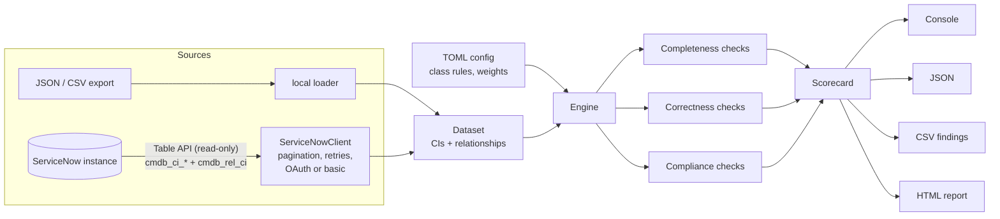

# servicenow-cmdb-health-toolkit

[](https://github.com/akramservicenow-sketch/servicenow-cmdb-health-toolkit/actions/workflows/ci.yml)


A Python package and CLI (`cmdb-health`) that scores ServiceNow CMDB data quality across the
three CMDB Health dimensions (**Completeness, Correctness, Compliance**) using CSDM-style
expectations. It runs against local JSON/CSV exports or a live instance through the read-only
Table API, and writes console, JSON, CSV and self-contained HTML reports.

> **Note:** This is an independent, representative portfolio project built with synthetic data; not code from any employer or client.
> Every CI, relationship, hostname and owner in `sample_data/` was produced by
> `scripts/generate_synthetic_cmdb.py`.

---

## The problem

A CMDB that looks full can still be unreliable. Incidents get routed to the wrong group because
the CI has no owner. Change impact analysis misses dependencies because servers have no
relationships. Discovery creates a second record because a serial number arrived as
`To Be Filled By O.E.M.`. The platform's CMDB Health dashboard covers part of this, but teams
often need something that:

* runs **before** data is loaded (on an import file or a Discovery staging export),
* can be scheduled in a pipeline and **fail a build** when quality drops,
* produces a remediation list that can go straight into a tracker or a spreadsheet,
* explains *why* a CI failed, including what the IRE would do with it.

## Checks catalog

| Check ID | Dimension | What it flags | Default severity |
|---|---|---|---|
| `MISSING_MANDATORY` | Completeness | Required attributes missing for the CI's class. Requirements are inherited up the class hierarchy (a Linux server inherits `cmdb_ci_hardware` and `cmdb_ci_computer` rules). Placeholder serials count as missing. | medium (high if 3 or more are missing) |
| `DUPLICATE_CI` | Correctness | CIs that share a normalised serial number, a normalised MAC (`AA:BB..`, `aa-bb..` and Cisco `aabb.ccdd.eeff` all match), or the same name within one class (FQDN reduced to host name). | high |
| `ORPHAN_CI` | Correctness | CIs with no parent or child relationship in `cmdb_rel_ci`. Service classes are exempt by default. | medium |
| `STALE_CI` | Correctness | Discoverable CIs (hardware, VM instances) not discovered in `stale_days`, or never discovered. | medium (high if never discovered) |
| `IDENTIFICATION_RULE` | Correctness | Simulates IRE identifier entries in priority order. Flags CIs that no entry can identify (IRE would reject them or insert a new CI) and CIs identified only by a weak fallback such as `name`. | high / low |
| `INVALID_RELATIONSHIP` | Compliance | Relationship types not on the allow-list, types not suggested for the parent/child class pair (e.g. app `Depends on` server instead of `Runs on`), and relationships pointing at CIs that do not exist. | medium / low / high |
| `UNOWNED_CI` | Compliance | None of the ownership fields (default `support_group`, `owned_by`) is populated. | medium |

Retired CIs (`install_status = 7`) are excluded from scope by default.

**Scoring.** Each check scores the share of evaluated CIs with no finding. A dimension's score
is the mean of its checks, and the overall score is a weighted mean of the dimensions
(weights are configurable).

## Architecture



```
src/cmdb_health/
  cli.py              argparse entry point (cmdb-health)
  config.py           defaults: class hierarchy, mandatory attrs, IRE rules, relationship rules
  engine.py           runs checks, computes dimension and overall scores
  models.py           Dataset, Relationship, Finding, CheckResult
  normalize.py        MAC / serial / name / date normalisation
  checks/             completeness.py, correctness.py, compliance.py
  sources/            local.py (JSON/CSV), servicenow.py (Table API client)
  reports/            console, json, csv, html
scripts/generate_synthetic_cmdb.py
sample_data/          committed synthetic export (64 CIs, 59 relationships)
docs/                 sample_report.html, sample_report.json, sample_output.txt
```

## Setup

```bash
git clone https://github.com/akramservicenow-sketch/servicenow-cmdb-health-toolkit.git
cd servicenow-cmdb-health-toolkit
python -m venv .venv && source .venv/bin/activate
pip install -e ".[dev]"
pytest            # 71 tests, no network needed
ruff check .
```

Docker:

```bash
docker build -t cmdb-health .
docker run --rm cmdb-health                       # scans the bundled synthetic sample
docker run --rm --env-file .env cmdb-health scan --source servicenow --format console
```

## Usage

```bash
# list checks
cmdb-health checks

# scan the synthetic sample and write every report format
cmdb-health scan \
  --cis sample_data/cis.json --relationships sample_data/relationships.json \
  --as-of 2026-10-01 --format console,json,csv,html --output-dir reports

# CSV exports work too
cmdb-health scan --cis sample_data/cis.csv --relationships sample_data/relationships.csv

# gate a pipeline: exit code 2 if the overall score is below 90
cmdb-health scan --cis export.json --fail-under 90

# live instance (credentials come from environment variables only)
cp .env.example .env    # fill in, then export the variables or use direnv
cmdb-health scan --source servicenow \
  --tables cmdb_ci_server,cmdb_ci_vm_instance,cmdb_ci_appl \
  --query "install_status!=7^operational_status=1" --format html

# regenerate synthetic data (deterministic per seed)
python scripts/generate_synthetic_cmdb.py --count 200 --seed 7 --out /tmp/cmdb-200
```

Sample console output (full file: [`docs/sample_output.txt`](docs/sample_output.txt)):

```
OVERALL SCORE     93.2  [###################.]
  Completeness    93.7  [###################.]
  Correctness     92.2  [##################..]
  Compliance      93.8  [###################.]

Check                        Dimension      Eval  Fail  Score
------------------------------------------------------------
MISSING_MANDATORY            completeness     63     4   93.7
DUPLICATE_CI                 correctness      63     6   90.5
ORPHAN_CI                    correctness      59     6   89.8
STALE_CI                     correctness      46     3   93.5
IDENTIFICATION_RULE          correctness      63     3   95.2
INVALID_RELATIONSHIP         compliance       40     3   92.5
UNOWNED_CI                   compliance       63     3   95.2

Findings: 28 (high 10, medium 15, low 3)
  [HIGH  ] DUPLICATE_CI         srvlx002: Possible duplicate matched on serial_number
  [HIGH  ] STALE_CI             srvlx011: CI has never been discovered
  [MEDIUM] INVALID_RELATIONSHIP reporting-etl-04: Relationship type 'Owns::Owned by' is not on the allow-list
  ...
```

The HTML report ([`docs/sample_report.html`](docs/sample_report.html), download and open it locally)
is one file with inline CSS and JS: a scorecard per dimension, a per-check table and a filterable
findings list. It follows the OS light/dark setting and loads nothing from the network.

### Accepted input shapes

* `{"result": [...]}`: a Table API response saved to disk
* `{"records": [...]}`: a JSONv2 export
* `{"cis": [...], "relationships": [...]}`: one bundle file
* a bare JSON list, or CSV with a header row

Reference fields may be plain sys_ids or `{"value": ..., "link": ...}` objects. Relationship
type may be provided as `type`, `type_name` or the dot-walked `type.name`.

## Configuration

Defaults live in `src/cmdb_health/config.py`. Override them with a TOML file:

```bash
cmdb-health scan --cis export.json --config config/cmdb-health.example.toml
```

| Key | Default | Purpose |
|---|---|---|
| `stale_days` | `30` | Discovery age threshold |
| `stale_check_classes` | hardware, VM instance | Classes expected to be discovered |
| `orphan_exempt_classes` | `cmdb_ci_service` | Classes allowed to have no relationships |
| `ownership_fields` | `support_group`, `owned_by` | At least one must be set |
| `exclude_install_status` | `["7"]` | Out-of-scope install statuses |
| `mandatory_attributes` | per class | Merged with defaults; inherited down the hierarchy |
| `identification_rules` | per class | Ordered entries with a `strong` flag |
| `allowed_relationship_types` | 8 common types | Global allow-list |
| `relationship_rules` | app/server, service/app, VM/server | Suggested types per class pair |
| `class_hierarchy` | common CMDB classes | Child to parent, merged with defaults |
| `dimension_weights` | 1 / 1 / 1 | Weighted overall score |
| `disabled_checks` | `[]` | e.g. `["ORPHAN_CI"]` |

Unknown keys are rejected so a typo cannot silently disable a rule.

### Environment variables (live source)

| Variable | Notes |
|---|---|
| `SN_INSTANCE_URL` | Must be `https://` |
| `SN_AUTH_MODE` | `oauth` (recommended) or `basic` |
| `SN_CLIENT_ID`, `SN_CLIENT_SECRET` | OAuth application registry entry |
| `SN_OAUTH_GRANT` | `client_credentials` (default) or `password` |
| `SN_USERNAME`, `SN_PASSWORD` | Basic auth, or the resource owner for the password grant |
| `SN_TIMEOUT`, `SN_PAGE_SIZE`, `SN_MAX_RETRIES`, `SN_VERIFY_TLS` | Tuning |

The client pages with `sysparm_limit`/`sysparm_offset` and adds `ORDERBYsys_id` so pages stay
stable. It requests only the fields the checks need (`sysparm_fields`), retries 429/5xx and
connection errors with exponential backoff (honouring `Retry-After`), refreshes an expired
OAuth token once on 401, and never retries 403.

## Security

* **Least privilege.** Use a dedicated integration user with read-only access to `cmdb_ci*`,
  `cmdb_rel_ci` and `cmdb_rel_type`. `snc_read_only` blocks all writes for that user; pair it
  with a role that grants read on CMDB tables (e.g. `itil`, or better a custom
  `x_cmdb_health_reader` role that holds only the needed table-level read ACLs). Mark it
  *Web service access only* so it cannot log in interactively.
* **ACLs.** The Table API enforces ACLs, so fields the user cannot read come back empty and
  will show up as "missing". If a scan reports a whole column missing, check field-level
  ACLs before blaming the data.
* **Credentials** are read from environment variables only. They are never written to
  reports, and `ServiceNowSettings.__repr__` hides them. `.env` is git-ignored; only
  `.env.example` with placeholders is committed. In CI, use the platform's secret store.
* **Transport.** `https://` is required. TLS verification is on unless explicitly disabled
  for a lab instance.
* **Output hygiene.** HTML output is escaped, and CSV cells that start with `= + - @` are
  prefixed with `'` to block spreadsheet formula injection. Reports can still contain CI
  names and IPs, so treat them as internal documents.
* **Rate limits.** Keep `SN_PAGE_SIZE` reasonable (500 to 1000) and schedule large scans
  outside peak hours. The instance's REST rate-limit rules still apply.

## Limitations

* The identification simulation covers ordered identifier entries and fallbacks. It does
  not model dependent-CI identification (e.g. an application identified through its host),
  lookup tables such as `cmdb_ci_network_adapter`, or reconciliation and data-source
  precedence rules.
* Duplicate detection is exact-match after normalisation. Fuzzy name matching is not done.
* Relationship suggestions are a small built-in set rather than the full
  `cmdb_rel_type_suggest` table.
* With the live source, `cmdb_rel_ci` is read in full and then filtered locally. On very large
  CMDBs, narrow the scope with `--query` or work from an export.
* When only some classes are loaded, relationships whose other end falls outside that scope
  are not reported as dangling.

## Roadmap

- [ ] Read identification rules and suggested relationships directly from the instance
      (`cmdb_identifier`, `cmdb_identifier_entry`, `cmdb_rel_type_suggest`)
- [ ] Dependent-CI identification and network adapter lookup rules
- [ ] Trend mode: compare two JSON reports and show regressions
- [ ] Optional write-back: create remediation tasks through a scoped app API
- [ ] CSDM layer checks (business application to application service to technical service)

## License

[MIT](LICENSE) © Shaik Akram
